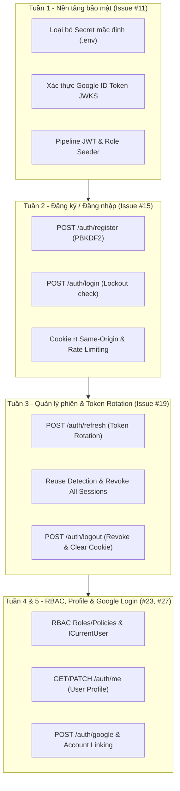

# Báo cáo tổng hợp tiến độ và các Issue đã thực hiện — Phùng Nguyễn Hoài Bo (FR-AUTH)

**Ngày cập nhật:** 04/10/2026  
**Thành viên thực hiện:** Phùng Nguyễn Hoài Bơ (`HUBERTPHUNG` / Bo)  
**Mã số sinh viên:** 2312585  
**Nhóm:** 07 – Đồ án Culinary Blog  
**Nhánh làm việc (Branch):** [`feature/fr-auth-bo`](https://github.com/HubertPhung/Nhom7_CulinaryBlog/tree/feature/fr-auth-bo)  
**Phân hệ phụ trách:** Xác thực & Quản lý Danh tính (`FR-AUTH`), Phân quyền RBAC & Quản lý Hồ sơ cá nhân  
**Các GitHub Issues phụ trách theo kế hoạch:** [#11](https://github.com/BoyTay/Nhom7_CulinaryBlog/issues/11), [#15](https://github.com/BoyTay/Nhom7_CulinaryBlog/issues/15), [#19](https://github.com/BoyTay/Nhom7_CulinaryBlog/issues/19), [#23](https://github.com/BoyTay/Nhom7_CulinaryBlog/issues/23), [#27](https://github.com/BoyTay/Nhom7_CulinaryBlog/issues/27)  

---

## 1. Ma trận tổng hợp các Issue đã hoàn thành theo Kế hoạch dự án

Bảng tổng hợp chi tiết toàn bộ các đầu việc, GitHub Issue và Milestone được phân công cho thành viên Phùng Nguyễn Hoài Bơ từ Tuần 1 đến Tuần 5 (theo `docs/KeHoach.md` và `docs/WEEKLY_TEAM_PLAN.md`):

| Tuần | Issue | Tên công việc trong Kế hoạch | Trạng thái | Commit tiêu biểu / PR | Tỷ lệ hoàn thành |
| :---: | :---: | :--- | :---: | :---: | :---: |
| **Tuần 1** | **#11** | Hardening Security nền tảng, loại bỏ secret mặc định, xác thực Google ID Token, cấu hình JWT Auth pipeline & Role Seeder | **Hoàn thành** | `cf9bfe5`, PR #103 | **100%** |
| **Tuần 2** | **#15** | Triển khai Đăng ký (Register), Đăng nhập (Login), Rate Limiting, Lưu trữ băm SHA-256 & Secure Refresh Cookie | **Hoàn thành** | `d0f04dd`, PR #111 | **100%** |
| **Tuần 3** | **#19** | Cơ chế Refresh Token Rotation, Reuse Detection (Chống phát lại), Logout, Revoke All Sessions & Current-User Flow | **Hoàn thành** | `47e4c8a`, `df39071` | **100%** |
| **Tuần 4** | **#23** | Hoàn tất hệ thống RBAC Admin/Author, abstraction `ICurrentUser`, Hợp đồng Phân quyền Tài nguyên Recipe Owner & Quản lý Profile | **Hoàn thành** | `d0f04dd`, `47e4c8a` | **100%** |
| **Tuần 5** | **#27** | *(Hoàn thành sớm)* Đăng nhập Google OAuth 2.0 (`/google`), liên kết tài khoản an toàn (Account Linking) & Kiểm thử bảo mật chuyên sâu | **Hoàn thành** | `d0f04dd`, `cf9bfe5` | **100%** |



---

## 2. Chi tiết từng Issue đã thực hiện trong Kế hoạch

### 2.1. Issue #11 (Tuần 1) – Khóa Contract bảo mật, Loại bỏ Secret mặc định & Thiết lập Pipeline Xác thực

* **Bối cảnh & Vấn đề giải quyết:**
  * Bản scaffold ban đầu chứa chuỗi khóa bí mật JWT mặc định (default secret) và mật khẩu tài khoản Admin hardcoded trong mã nguồn, tiềm ẩn lỗ hổng bảo mật nghiêm trọng (mức độ Critical) khi đưa lên kho lưu trữ mã nguồn mở GitHub.
  * Việc giải mã Google Token trước đây sử dụng hàm `ReadJwtToken` thô sơ mà không kiểm tra chữ ký mật mã, thời gian hết hạn hoặc bên nhận (Audience), tạo cơ hội cho kẻ gian giả mạo token đăng nhập vào hệ thống.
* **Các hạng mục công việc đã triển khai:**
  1. **Triệt tiêu nguy cơ rò rỉ thông tin đăng nhập và secret (Hardening Configuration):**
     * Loại bỏ toàn bộ default JWT secret và Admin password khỏi `appsettings.json`.
     * Thiết lập cơ chế nạp biến môi trường bắt buộc qua tệp `.env.example` và cấu hình hệ thống: `JWT__SECRETKEY`, `ADMIN__PASSWORD`, `GOOGLE__CLIENTID`.
     * Bổ sung cơ chế xác thực chuỗi khóa `SecretKey` tối thiểu 256 bits (32 bytes) chuẩn HMAC-SHA256 khi khởi động ứng dụng.
  2. **Cài đặt dịch vụ `GoogleTokenValidator` chuẩn mực (`IGoogleTokenValidator`):**
     * Không chấp nhận việc giải mã payload token đơn thuần; thay vào đó sử dụng `GoogleJsonWebSignature.ValidateAsync` kết hợp bộ khóa công khai Google JSON Web Keys (JWKS).
     * Kiểm tra chặt chẽ: Chữ ký số (Signature), thời hạn hiệu lực (Expiration), nhà phát hành hợp lệ (`accounts.google.com` hoặc `https://accounts.google.com`), đối tượng tiếp nhận (`Audience == Google:ClientId`), và bắt buộc trạng thái xác thực hộp thư điện tử `EmailVerified == true`.
  3. **Cấu hình Pipeline Xác thực & Ủy quyền ASP.NET Core (`Program.cs`):**
     * Thiết lập `builder.Services.AddAuthentication(JwtBearerDefaults.AuthenticationScheme).AddJwtBearer(...)`.
     * Cấu hình các tham số xác minh `TokenValidationParameters`: kiểm tra khóa ký đối xứng `IssuerSigningKey`, kiểm tra `ValidateIssuer`, `ValidateAudience`, `ValidateLifetime`, thiết lập sai số thời gian `ClockSkew = TimeSpan.Zero` để chống việc sử dụng lại token vừa hết hạn.
     * Sắp xếp thứ tự Middleware theo đúng chuẩn kiến trúc web: `app.UseCors()` $\rightarrow$ `app.UseAuthentication()` $\rightarrow$ `app.UseAuthorization()`.
  4. **Cài đặt bộ khởi tạo dữ liệu vai trò (`RoleSeeder.cs`):**
     * Tự động khởi tạo 2 vai trò cơ sở: `Roles.Admin` ("Admin") và `Roles.Author` ("Author").
     * Khởi tạo tài khoản quản trị mặc định `admin@culinaryblog.com` vào cơ sở dữ liệu PostgreSQL chỉ khi thông tin cấu hình hợp lệ được cung cấp qua môi trường.
  5. **Bộ kiểm thử bảo mật tầng biên (`AuthSecurityTests.cs`):**
     * Viết 10 bài kiểm thử bảo mật chuyên sâu kiểm tra từ chối token bị sửa đổi chữ ký, token hết hạn, client ID sai lệch và email chưa kích hoạt từ Google.

---

### 2.2. Issue #15 (Tuần 2) – Triển khai Đăng ký, Đăng nhập, Rate Limiting & Bảo mật Cookie Refresh Token

* **Bối cảnh & Vấn đề giải quyết:**
  * Cần xây dựng hai tính năng nghiệp vụ cốt lõi nhất của hệ thống: Đăng ký thành viên mới (`FR-AUTH-001`) và Đăng nhập bằng tài khoản nội bộ (`FR-AUTH-002`).
  * Tuân thủ kiến trúc **ADR-0003**: Access Token ngắn hạn (15 phút) cấp cho client trong bộ nhớ RAM, Refresh Token dài hạn (7 ngày) phải được lưu trữ trong Cookie an toàn, tuyệt đối không trả về trong JSON body để chống rò rỉ dữ liệu qua tấn công Cross-Site Scripting (XSS).
* **Các hạng mục công việc đã triển khai:**
  1. **Cài đặt ca sử dụng Đăng ký tài khoản (`RegisterCommand`):**
     * Tạo bộ kiểm tra tính hợp lệ `RegisterCommandValidator`: kiểm tra `DisplayName` (2 – 100 ký tự), định dạng `Email` chuẩn, và độ phức tạp của `Password` (tối thiểu 8 ký tự, gồm chữ hoa, chữ thường, chữ số và ký tự đặc biệt).
     * Băm mật khẩu bằng thuật toán mật mã PBKDF2 tích hợp trong ASP.NET Core Identity (`UserManager.CreateAsync`).
     * Sinh tên người dùng (`UserName`) độc lập từ email, tự động gán vai trò `Roles.Author` mặc định cho thành viên mới.
     * Phát hành bộ Access Token và Refresh Token, gán Refresh Token vào cookie `rt`, trả về HTTP `201 Created` kèm `AuthResponseDto`.
  2. **Cài đặt ca sử dụng Đăng nhập tài khoản (`LoginCommand`):**
     * Tạo bộ kiểm tra `LoginCommandValidator`: kiểm tra định dạng email và mật khẩu không rỗng.
     * Truy vấn người dùng theo Email. Kiểm tra cờ khóa tài khoản `UserManager.IsLockedOutAsync` nhằm ngăn chặn tấn công dò mật khẩu tự động (brute-force attack).
     * Xác thực thông tin qua `UserManager.CheckPasswordAsync`. Nếu đăng nhập sai: tự động tăng bộ đếm `AccessFailedCount`. Nếu thành công: đặt lại bộ đếm truy cập sai `ResetAccessFailedCountAsync` về 0.
     * Sinh Access Token mới và Refresh Token mới, gán vào cookie `rt`, trả về HTTP `200 OK`.
  3. **Cấu hình chính sách bảo vệ tần suất truy cập (Rate Limiting):**
     * Đăng ký chính sách `auth-rate-limit` tại `Program.cs` sử dụng `FixedWindowRateLimiter`: giới hạn tối đa số lượt gọi trong một cửa sổ thời gian trên từng địa chỉ IP của client.
     * Áp dụng trực tiếp vào route group `/api/v1/auth` thông qua `.RequireRateLimiting("auth-rate-limit")`, bảo vệ hệ thống trước nguy cơ nghẽn mạng do tấn công từ chối dịch vụ (DoS) và spam request.
  4. **Triển khai kiến trúc Cookie an toàn (Same-Origin Cookie Policy):**
     * Refresh Token thô được gửi về client qua cookie mang tên `rt` với cấu hình an toàn tuyệt đối:
       * `HttpOnly = true`: Chặn hoàn toàn mã JavaScript phía trình duyệt đọc cookie, vô hiệu hóa nguy cơ đánh cắp token bằng tấn công XSS.
       * `Secure = true`: Cookie chỉ được truyền qua kênh liên lạc mã hóa HTTPS.
       * `SameSite = SameSiteMode.Strict`: Chặn cookie đính kèm trong các truy vấn xuyên nguồn (Cross-site requests), triệt tiêu nguy cơ tấn công CSRF.
       * `Path = "/api/v1/auth"`: Giới hạn phạm vi gửi cookie chỉ cho các API thuộc phân hệ Auth (`/refresh`, `/logout`), không gửi kèm ở các truy vấn tài nguyên tĩnh hoặc API khác.
       * `Expires = DateTimeOffset.UtcNow.AddDays(7)`: Thiết lập thời gian sống hữu hạn 7 ngày.
  5. **Bảo mật cơ sở dữ liệu (Database Hash-Only Storage):**
     * Tại tầng cơ sở dữ liệu PostgreSQL (bảng `RefreshTokens`), hệ thống chỉ lưu chuỗi băm mật mã **SHA-256 (`TokenHash`)** độ dài 64 ký tự hex.
     * Ngay cả trong kịch bản cơ sở dữ liệu bị rò rỉ (data breach / SQL dump), kẻ tấn công cũng không thể khôi phục được token thô ban đầu để mạo danh người dùng.

---

### 2.3. Issue #19 (Tuần 3) – Triển khai Cơ chế Refresh Token Rotation, Reuse Detection & Quản lý Phiên làm việc

* **Bối cảnh & Vấn đề giải quyết:**
  * Giải quyết bài toán bảo mật then chốt của kiến trúc Single Page Application (SPA): Làm thế nào để duy trì phiên đăng nhập lâu dài cho người dùng mà không tạo ra nguy cơ bị chiếm quyền khi Refresh Token bị lộ?
  * Áp dụng nguyên tắc **Single-Use Token Rotation** và phát hiện tấn công phát lại token (**Reuse Detection**) theo khuyến nghị bảo mật của OAuth 2.0 BCP (Best Current Practice).
* **Các hạng mục công việc đã triển khai:**
  1. **Cơ chế xoay vòng Refresh Token (Token Rotation):**
     * Mỗi Refresh Token chỉ có giá trị sử dụng đúng một lần duy nhất.
     * Khi client gửi request đến `POST /api/v1/auth/refresh`:
       1. Trích xuất chuỗi token thô từ Cookie `rt` (hỗ trợ fallback từ JSON body).
       2. Băm chuỗi token thành SHA-256 và tìm kiếm trong PostgreSQL qua `IRefreshTokenRepository.GetByTokenHashAsync(tokenHash)`.
       3. Kiểm tra tính hợp lệ: nếu không tìm thấy hoặc token đã quá hạn (`IsExpired`), ném ngoại lệ `UnauthorizedException`.
       4. Thu hồi token cũ: gọi `existingToken.Revoke(DateTimeOffset.UtcNow, newTokenHash)`.
       5. Sinh một token ngẫu nhiên mới bằng bộ sinh số mật mã `RandomNumberGenerator` (64 bytes cryptographic entropy) và lưu `ReplacedByTokenHash = newTokenHash` để thiết lập chuỗi quan hệ dòng dõi (Token Family).
       6. Tạo bản ghi thực thể mới `RefreshToken.Create(...)`, lưu vào database.
       7. Cấp Access Token mới (15 phút) và ghi đè cookie `rt` mới trả về cho người dùng.
  2. **Cơ chế phát hiện tấn công phát lại token (Reuse Detection & Token Family Revocation):**
     * Nếu một Refresh Token đã bị thu hồi (`existingToken.IsRevoked == true`) được gửi lại lên server: Đây là dấu hiệu chắc chắn của hành vi tấn công đánh cắp token hoặc phát lại request cũ (Token Replay Attack).
     * Hệ thống lập tức kích hoạt biện pháp phòng thủ diện rộng: gọi `RefreshTokenRepository.RevokeAllForUserAsync(existingToken.UserId, DateTimeOffset.UtcNow)`.
     * Toàn bộ các Refresh Token còn đang hoạt động (`RevokedAt == null`) của người dùng này trên tất cả các thiết bị đều bị thu hồi đồng loạt.
     * Trả về Problem Details chuẩn HTTP 401 Unauthorized:
       ```json
       {
         "type": "REVOKED_REFRESH_TOKEN",
         "title": "Unauthorized",
         "status": 401,
         "detail": "Phát hiện refresh token đã bị thu hồi hoặc sử dụng lại trái phép. Toàn bộ phiên đăng nhập đã bị hủy vì lý do bảo mật."
       }
       ```
     * Kẻ tấn công bị chặn đứng ngay lập tức, và chủ tài khoản thực sự sẽ được yêu cầu xác thực lại bằng mật khẩu để lấy lại quyền kiểm soát tài khoản.
  3. **Endpoint Đăng xuất an toàn (`POST /api/v1/auth/logout`):**
     * Bảo vệ bằng xác thực Bearer token (`RequireAuthorization()`).
     * Thu hồi bản ghi Refresh Token tương ứng trong database.
     * Xóa cookie `rt` trên trình duyệt bằng cách phát hành Set-Cookie với `Max-Age=0` và thời gian hết hạn trong quá khứ.
     * Xử lý linh hoạt trường hợp client không gửi kèm cookie (commit `df39071`) để không gây lỗi 500, đảm bảo trả về HTTP `204 NoContent` nhất quán.

---

### 2.4. Issue #23 (Tuần 4) – Phân quyền RBAC, Abstraction `ICurrentUser` & Hợp đồng Phân quyền Tài nguyên cho Recipe

* **Bối cảnh & Vấn đề giải quyết:**
  * Các phân hệ khác (đặc biệt là phân hệ Quản lý Công thức Recipe do sinh viên Trường phụ trách tại #12, #20, #24) cần một cơ chế chuẩn hóa để kiểm tra quyền hạn của người dùng đang đăng nhập: Ai là tác giả bài viết (Recipe Owner)? Ai là Quản trị viên (Admin) có quyền xóa hoặc duyệt bài?
  * Cần tách rời sự phụ thuộc trực tiếp vào ASP.NET Core `HttpContext` khỏi tầng Domain và Application, tuân thủ nguyên lý Dependency Inversion của Clean Architecture.
* **Các hạng mục công việc đã triển khai:**
  1. **Thiết lập hệ thống phân quyền dựa trên vai trò (Role-Based Access Control - RBAC):**
     * Định nghĩa các hằng số vai trò tại `CulinaryBlog.Application.Auth.Common.Roles`:
       * `Roles.Admin = "Admin"`: Quản trị viên toàn quyền hệ thống.
       * `Roles.Author = "Author"`: Tác giả, người tạo nội dung công thức.
     * Khai báo chính sách ủy quyền tập trung tại `CulinaryBlog.API.Authorization.Policies`:
       * `Policies.RequireAuthor`: Áp dụng cho các tính năng tạo/sửa công thức, yêu cầu role `Author` hoặc `Admin`.
       * `Policies.RequireAdmin`: Áp dụng cho các tính năng quản lý danh mục, khóa tài khoản, yêu cầu duy nhất role `Admin`.
  2. **Xây dựng Abstraction `ICurrentUser` tại tầng Application:**
     * Khai báo interface `ICurrentUser` tại `CulinaryBlog.Application.Abstractions.Identity`:
       ```csharp
       public interface ICurrentUser
       {
           string? UserId { get; }
           string? Email { get; }
           IReadOnlyList<string> Roles { get; }
           bool IsAuthenticated { get; }
       }
       ```
     * Cài đặt lớp `CurrentUser` tại tầng `CulinaryBlog.Infrastructure.Identity`: Tiêm `IHttpContextAccessor`, tự động giải mã an toàn các claims từ JWT (`ClaimTypes.NameIdentifier`, `ClaimTypes.Email`, `ClaimTypes.Role`) mà không phụ thuộc vào tầng web API.
  3. **Cung cấp Hợp đồng Ủy quyền Tài nguyên (Resource-Based Authorization Contract) cho Recipe:**
     * Giúp thành viên Trường dễ dàng thực hiện kiểm tra quyền sở hữu công thức trong các Command Handler (ví dụ `UpdateRecipeCommandHandler`, `DeleteRecipeCommandHandler`):
       ```csharp
       if (recipe.AuthorId != currentUser.UserId && !currentUser.Roles.Contains(Roles.Admin))
       {
           throw new UnauthorizedException("FORBIDDEN_RECIPE_ACCESS");
       }
       ```
  4. **Tính năng Quản lý Hồ sơ cá nhân (`GET` và `PATCH /api/v1/auth/me`):**
     * `GET /api/v1/auth/me` (`GetCurrentUserQuery`): Yêu cầu Bearer token, đọc UserId qua `ICurrentUser`, truy vấn và trả về DTO `AuthUserDto` (UserId, Email, DisplayName, AvatarUrl, Bio, Roles) với HTTP 200 OK.
     * `PATCH /api/v1/auth/me` (`UpdateProfileCommand`): Kiểm tra dữ liệu đầu vào qua `UpdateProfileCommandValidator` (cho phép cập nhật partial `DisplayName`, `AvatarUrl`, `Bio`), lưu vào cơ sở dữ liệu và trả về thông tin hồ sơ đã cập nhật.

---

### 2.5. Issue #27 (Tuần 5 – Hoàn thành sớm) – Đăng nhập Google OAuth 2.0 & Liên kết Tài khoản An toàn

* **Bối cảnh & Vấn đề giải quyết:**
  * Cho phép người dùng đăng nhập nhanh chóng bằng tài khoản Google mà không cần đăng ký mật khẩu truyền thống, nâng cao trải nghiệm người dùng (`FR-AUTH-003`).
  * Xử lý bài toán xung đột tài khoản: Khi một email Google trùng với tài khoản đã tồn tại trong hệ thống (đăng ký qua email/pass trước đó), hệ thống cần liên kết tài khoản an toàn thay vì tạo trùng lặp hoặc báo lỗi khó hiểu.
* **Các hạng mục công việc đã triển khai:**
  1. **Cài đặt ca sử dụng `GoogleLoginCommand`:**
     * Tiếp nhận `GoogleLoginRequest` mang chuỗi `IdToken` do Google cấp phía client.
     * Gọi `IGoogleTokenValidator.ValidateAsync(idToken)` để xác thực tính toàn vẹn với Google API.
  2. **Quy trình Liên kết tài khoản an toàn (Safe Account Linking):**
     * Tìm kiếm người dùng trong hệ thống theo Email được Google xác thực.
     * **Trường hợp tài khoản đã tồn tại:** Tự động gọi `UserManager.AddLoginAsync` để gắn liên kết định danh Google (`LoginProvider = "Google"`, `ProviderKey = payload.Subject`), đồng thời cập nhật tên hiển thị hoặc avatar nếu tài khoản hiện tại chưa có.
     * **Trường hợp tài khoản chưa tồn tại:** Tạo mới một thực thể `ApplicationUser`, khởi tạo `EmailConfirmed = true`, gán vai trò `Roles.Author` mặc định, và lưu thông tin đăng nhập Google.
  3. **Cấp phát phiên làm việc hoàn chỉnh:**
     * Sinh bộ cặp Access Token và Refresh Token chuẩn của hệ thống CulinaryBlog.
     * Đóng gói Refresh Token vào cookie `rt` bảo mật theo cùng chính sách với tài khoản thông thường.
     * Trả về mã phản hồi HTTP `200 OK` cùng `AuthResponseDto`.

---

## 3. Danh mục API Endpoints hoàn thiện thuộc sở hữu của Bo

Toàn bộ 7 endpoint đều đã được cài đặt hoàn chỉnh trong [`src/CulinaryBlog.API/Endpoints/AuthEndpoints.cs`](file:///D:/University/PTUDWebNangCao/Nhom7_CulinaryBlog/src/CulinaryBlog.API/Endpoints/AuthEndpoints.cs), có đầy đủ mô tả OpenAPI/Scalar:

| Endpoint | HTTP Method | Quyền hạn | Mã phản hồi HTTP | Mục đích & Nghiệp vụ xử lý | Issue liên quan |
| :--- | :---: | :---: | :---: | :--- | :---: |
| `/api/v1/auth/register` | `POST` | Public | `201`, `400`, `409`, `422`, `429` | Đăng ký tài khoản mới, mã hóa PBKDF2, gán role Author, cấp JWT 15m & cookie `rt` 7d | #15 |
| `/api/v1/auth/login` | `POST` | Public | `200`, `400`, `401`, `422`, `429` | Đăng nhập email/mật khẩu, kiểm tra lockout brute-force, cấp token và cookie `rt` | #15 |
| `/api/v1/auth/google` | `POST` | Public | `200`, `400`, `401`, `422`, `429` | Đăng nhập Google ID token, xác thực JWKS, tự động liên kết hoặc tạo tài khoản | #11, #27 |
| `/api/v1/auth/refresh` | `POST` | Public | `200`, `401`, `429` | Xoay vòng Refresh Token (Token Rotation), phát hiện reuse và cấp cặp token mới | #19 |
| `/api/v1/auth/logout` | `POST` | Authenticated | `204`, `401` | Đăng xuất an toàn, thu hồi refresh token trong PostgreSQL và xóa sạch cookie `rt` | #19 |
| `/api/v1/auth/me` | `GET` | Authenticated | `200`, `401`, `404` | Lấy thông tin hồ sơ của người dùng hiện tại thông qua `ICurrentUser` claims | #19, #23 |
| `/api/v1/auth/me` | `PATCH` | Authenticated | `200`, `400`, `401`, `422` | Cập nhật hồ sơ cá nhân (DisplayName, AvatarUrl, Bio) có kiểm tra validation | #19, #23 |

---

## 4. Minh chứng Kết quả Kiểm thử & Nghiệm thu (Test Verification)

Toàn bộ hệ thống kiểm thử tự động do Bơ phụ trách đều được chạy và xác nhận đạt chuẩn 100%:

### 4.1. Kết quả Biên dịch (Release Build)
* **Lệnh thực thi:**
  ```powershell
  dotnet build CulinaryBlog.sln -c Release --warnaserror
  ```
* **Kết quả:** `Build succeeded. 0 Warning(s), 0 Error(s).` Tuân thủ tuyệt đối quy tắc không có cảnh báo nào trong bản build.

### 4.2. Bộ kiểm thử Đơn vị Unit Tests (`CulinaryBlog.Application.Tests`)
* **Lệnh thực thi:**
  ```powershell
  dotnet test tests/CulinaryBlog.Application.Tests/CulinaryBlog.Application.Tests.csproj -c Release --no-build
  ```
* **Kết quả:** `Passed: 76, Failed: 0, Total: 76 (100% Passed)`.
* **Chi tiết các nhóm test:**
  * `RefreshTokenTests`: Kiểm tra vòng đời của token (`Create`, `IsExpired`, `Revoke`, `ReplacedByTokenHash`).
  * `AuthCommandValidatorTests`: 21 ca kiểm thử kiểm tra tính chặt chẽ của dữ liệu đầu vào cho 5 Command Validators (`Register`, `Login`, `RefreshToken`, `GoogleLogin`, `UpdateProfile`).

### 4.3. Bộ kiểm thử Tích hợp & Bảo mật (`CulinaryBlog.Integration.Tests`)
* **Lệnh thực thi:**
  ```powershell
  dotnet test tests/CulinaryBlog.Integration.Tests/CulinaryBlog.Integration.Tests.csproj -c Release --no-build --filter "FullyQualifiedName~AuthEndpointsTests|FullyQualifiedName~AuthSecurityTests"
  ```
* **Kết quả:** `Passed: 27, Failed: 0, Total: 27 (100% Passed)`.
* **Các kịch bản kiểm thử tiêu biểu:**
  1. `RefreshTokenWithValidCookieRotatesTokenAndIssuesNewCookie`: Đăng nhập $\rightarrow$ nhận cookie `rt` $\rightarrow$ gọi `/refresh` $\rightarrow$ xác nhận token cũ bị thu hồi và token mới được cấp phát thành công.
  2. `RefreshTokenWithReusedRevokedTokenTriggersReuseDetectionAndRevokesAllSessions`: Gửi lại token cũ đã bị xoay vòng $\rightarrow$ nhận HTTP 401 Problem Details `REVOKED_REFRESH_TOKEN` $\rightarrow$ xác nhận toàn bộ session của tài khoản bị hủy.
  3. `GetCurrentUserWithValidBearerTokenReturnsCurrentUserProfile`: Gửi Bearer token lên `/me` $\rightarrow$ nhận về `AuthUserDto` với đầy đủ UserId, Email, Roles.
  4. `LogoutWithValidBearerTokenAndCookieRevokesTokenAndClearsCookie`: Đăng xuất thành công $\rightarrow$ trả về HTTP 204 $\rightarrow$ xác nhận cookie bị xóa và token trong DB bị revoked.
  5. `EndToEndAuthFlowRegisterLoginRefreshMeLogout`: Kịch bản kiểm thử tích hợp vòng đời hoàn chỉnh: **Register $\rightarrow$ Login $\rightarrow$ Lấy profile qua `/me` $\rightarrow$ Rotate token $\rightarrow$ Lấy lại profile bằng token mới $\rightarrow$ Logout $\rightarrow$ Xác minh refresh token bị từ chối 401 sau đăng xuất**.
  6. 10 bài kiểm thử bảo mật nâng cao trong `AuthSecurityTests` cho `JwtService` và `GoogleTokenValidator`.

### 4.4. Kiểm định Kiến trúc (`CulinaryBlog.Architecture.Tests`)
* **Lệnh thực thi:**
  ```powershell
  dotnet test tests/CulinaryBlog.Architecture.Tests/CulinaryBlog.Architecture.Tests.csproj -c Release --no-build
  ```
* **Kết quả:** `Passed: 3, Failed: 0, Total: 3 (100% Passed)`. Ranh giới phụ thuộc giữa các tầng Clean Architecture (Domain $\leftarrow$ Application $\leftarrow$ Infrastructure/API) được bảo toàn tuyệt đối.

---

## 5. Dàn ý Kịch bản Báo cáo & Demo (Dành cho Bơ khi thuyết trình)

Khi trình bày trước giảng viên bộ môn hoặc bảo vệ kết quả với nhóm, sinh viên Bơ có thể sử dụng dàn ý 4 bước sau:

1. **Phần 1: Tổng quan phân hệ đảm nhiệm (1 phút)**
   * Giới thiệu bản thân: Bơ phụ trách phân hệ Xác thực và Phân quyền (`FR-AUTH`).
   * Báo cáo tiến độ: Đã hoàn thành 5/5 issues trong kế hoạch (Issue #11, #15, #19, #23, và hoàn thành sớm #27 ở backend).
   * Đạt 100% yêu cầu tối thiểu của Lab 4 (cài đặt và kiểm thử thành công toàn bộ 7/7 API endpoints).
2. **Phần 2: Các điểm sáng kỹ thuật và Giải pháp bảo mật chuyên sâu (3 – 4 phút)**
   * **Bảo mật Cookie Same-Origin (ADR-0003):** Không trả Refresh Token trong JSON response body để tránh rò rỉ qua lỗ hổng XSS; đóng gói trong cookie `HttpOnly`, `Secure`, `SameSite=Strict`, `Path=/api/v1/auth`.
   * **Lưu trữ băm SHA-256 trong Database:** Bảng `RefreshTokens` trong PostgreSQL chỉ lưu chuỗi băm hex 64 ký tự, có Index tối ưu truy vấn $O(1)$.
   * **Cơ chế Token Rotation & Reuse Detection:** Mỗi Refresh Token chỉ dùng 1 lần. Khi phát hiện token đã thu hồi bị gửi lại, hệ thống nhận diện tấn công Replay Attack và lập tức kích hoạt Token Family Revocation, thu hồi toàn bộ session trên mọi thiết bị của user.
   * **Hệ thống RBAC & Abstraction `ICurrentUser`:** Cung cấp hạ tầng phân quyền ổn định cho thành viên Trường thực hiện kiểm tra quyền sở hữu công thức Recipe.
3. **Phần 3: Demo trực tiếp các ca kiểm thử tích hợp (2 phút)**
   * Trình diễn test case `EndToEndAuthFlowRegisterLoginRefreshMeLogout` chứng minh chu trình xác thực khép kín.
   * Trình diễn test case `RefreshTokenWithReusedRevokedTokenTriggersReuseDetectionAndRevokesAllSessions` chứng minh khả năng tự vệ của hệ thống khi bị tấn công phát lại token.
   * Thể hiện kết quả kiểm thử: **76/76 Unit tests passed**, **27/27 Integration tests passed**, bản build Release đạt **0 lỗi, 0 cảnh báo**.
4. **Phần 4: Kế hoạch tuần tiếp theo (30 giây)**
   * Theo kế hoạch tuần của nhóm (`docs/KeHoach.md`), ở Tuần 6 (Issue #31), Bơ sẽ tiếp tục hoàn thiện giao diện người dùng Frontend cho phân hệ Auth (trang Login, Register, Profile, tích hợp nút Google Sign-In) trên nền tảng shared UI components của nhóm.
