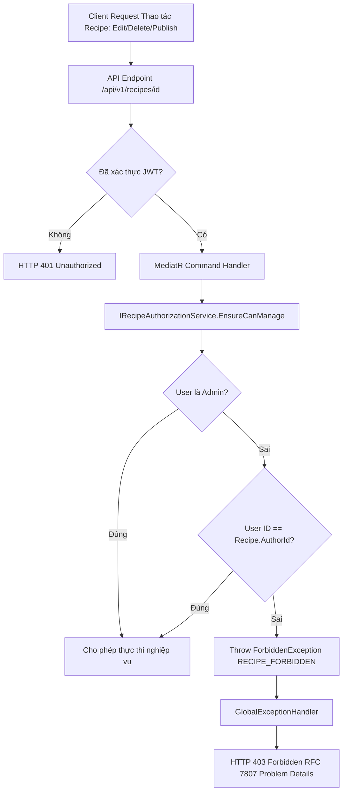

# Kế hoạch triển khai: Issue #23 — RBAC, Resource Authorization & Profile (Week 04)

> **Mã công việc:** [Issue #23](https://github.com/BoyTay/Nhom7_CulinaryBlog/issues/23)  
> **Người thực hiện:** Phùng Nguyễn Hoài Bộ (Owner: Identity / Auth / Security / Profile theo [docs/tree.md](../tree.md))  
> **Milestone:** Week 04 (Giao diện hợp đồng cho Trường — Recipe)

---

## 1. Goal Description

Theo kế hoạch tuần [docs/WEEKLY_TEAM_PLAN.md](../WEEKLY_TEAM_PLAN.md) và đặc tả [docs/SRS_Culinary_Blog_v1.0.0.md](../SRS_Culinary_Blog_v1.0.0.md) (mục NFR-SEC-006, FR-AUTH-006, FR-AUTH-007), mục tiêu tuần 4 của Bộ là hoàn thiện hạ tầng bảo mật & phân quyền làm nền tảng cho module Recipe của Trường, bao gồm:

1. **Hoàn thiện RBAC Admin/Author và `ICurrentUser`**: Bổ sung các thuộc tính tiện ích và chuẩn hoá kiểm tra quyền (`IsAdmin`, `IsAuthor`, danh sách `Roles`, trích xuất claims chặt chẽ).
2. **Công bố & Cài đặt Hợp đồng Phân quyền Tài nguyên (Recipe Owner / Admin Resource Authorization Contract)**:
   - Theo NFR-SEC-006: Phân quyền phải được kiểm tra tại **Application Layer** (trong MediatR Command Handlers) chứ không chỉ ở Presentation Layer.
   - Xây dựng service hợp đồng `IRecipeAuthorizationService` (trong `CulinaryBlog.Application`) để các handler của Recipe (Trường) có thể inject và gọi trực tiếp.
   - Xây dựng `RecipeAuthorizationHandler` (ASP.NET Core `AuthorizationHandler<RecipeOperationRequirement, Recipe>`) cho endpoint-level authorization.
   - Bổ sung ngoại lệ `ForbiddenException` (HTTP 403) và ánh xạ sang RFC 7807 Problem Details với mã lỗi chuẩn `RECIPE_FORBIDDEN`.
3. **Hoàn thiện luồng Xem & Cập nhật Hồ sơ (View / Update Profile)**:
   - Endpoint `GET /api/v1/auth/me` (FR-AUTH-006): Trả về `AuthUserDto` (không để lộ mật khẩu, security stamp).
   - Endpoint `PATCH /api/v1/auth/me` (FR-AUTH-007): Cập nhật `DisplayName`, `AvatarUrl`, `Bio` với FluentValidation chặt chẽ.
4. **Kiểm thử đầy đủ 4 kịch bản phân quyền (Authorization Outcomes)**:
   - **Anonymous**: HTTP 401 Unauthorized.
   - **Non-owner** (tác giả khác): HTTP 403 Forbidden với Problem Details `type = "RECIPE_FORBIDDEN"`.
   - **Owner** (chính chủ sở hữu recipe): Cho phép thao tác thành công.
   - **Admin** (quản trị viên hệ thống): Cho phép thao tác thành công trên mọi recipe dù không phải tác giả.



---

## 2. User Review Required

> [!IMPORTANT]
> **Ranh giới Hợp đồng giữa Bộ và Trường (`Bo ICurrentUser + policies ──► Trường`):**
> Hợp đồng `IRecipeAuthorizationService` được đặt tại layer `CulinaryBlog.Application` (`CulinaryBlog.Application.Abstractions.Identity`). Điều này giúp Trường khi viết `UpdateRecipeCommandHandler`, `DeleteRecipeCommandHandler` hoặc `PublishRecipeCommandHandler` chỉ cần inject `IRecipeAuthorizationService` và gọi:
> ```csharp
> recipeAuthorizationService.EnsureCanManage(recipe);
> ```
> mà không cần tự xử lý so sánh string ID hay lệ thuộc `HttpContext`.

> [!NOTE]
> **Quy chuẩn mã lỗi 403:**
> Theo SRS NFR-SEC-006 và bảng Problem Details chuẩn của đồ án, mã lỗi trả về khi không phải Owner và không phải Admin là `"RECIPE_FORBIDDEN"`.

---

## 3. Open Questions

1. **Tài liệu thuyết trình cá nhân tuần 4:**
   - Bạn có muốn tạo file thuyết trình `docs/fr-auth-bo/W04_BO_AUTH_PROGRESS_2026-10-07.md` tương tự như các tuần trước để phục vụ báo cáo với giảng viên không? (Sẽ được bổ sung và cấu hình bỏ qua trên git theo quy định).

---

## 4. Proposed Changes

### Component 1: `CulinaryBlog.Application` (Contracts & Exceptions)

#### [MODIFY] `src/CulinaryBlog.Application/Abstractions/Identity/ICurrentUser.cs`
- Bổ sung thuộc tính `IReadOnlyList<string> Roles { get; }`, `bool IsAdmin { get; }`, `bool IsAuthor { get; }` để tiện kiểm tra quyền ở các tầng nghiệp vụ.

```csharp
namespace CulinaryBlog.Application.Abstractions.Identity;

public interface ICurrentUser
{
    string? UserId { get; }
    string? Email { get; }
    bool IsAuthenticated { get; }
    bool IsInRole(string role);
    IReadOnlyList<string> Roles { get; }
    bool IsAdmin { get; }
    bool IsAuthor { get; }
}
```

#### [NEW] `src/CulinaryBlog.Application/Abstractions/Identity/IRecipeAuthorizationService.cs`
- Công bố hợp đồng kiểm tra quyền sở hữu Recipe:
```csharp
namespace CulinaryBlog.Application.Abstractions.Identity;

using CulinaryBlog.Domain.Recipes;

public interface IRecipeAuthorizationService
{
    bool CanManage(Recipe recipe);
    void EnsureCanManage(Recipe recipe);
    bool CanManage(string recipeAuthorId);
    void EnsureCanManage(string recipeAuthorId);
}
```

#### [NEW] `src/CulinaryBlog.Application/Common/Exceptions/ForbiddenException.cs`
- Tạo ngoại lệ phân quyền cho Application Layer:
```csharp
namespace CulinaryBlog.Application.Common.Exceptions;

public sealed class ForbiddenException : Exception
{
    public string Code { get; }

    public ForbiddenException(string message, string code = "FORBIDDEN")
        : base(message)
    {
        Code = code;
    }
}
```

#### [NEW] `src/CulinaryBlog.Application/Auth/Common/AuthorizationPolicies.cs`
- Định nghĩa hằng số tên policy tập trung theo SRS:
```csharp
namespace CulinaryBlog.Application.Auth.Common;

public static class AuthorizationPolicies
{
    public const string AuthorPolicy = "AuthorPolicy";
    public const string AdminPolicy = "AdminPolicy";
    public const string RequireAuthor = AuthorPolicy;
    public const string RequireAdmin = AdminPolicy;
}
```

---

### Component 2: `CulinaryBlog.Infrastructure` (Implementations & DI)

#### [MODIFY] `src/CulinaryBlog.Infrastructure/Identity/CurrentUser.cs`
- Cài đặt các thuộc tính mới của `ICurrentUser`:
  - `Roles`: lấy từ claims `ClaimTypes.Role`.
  - `IsAdmin`: kiểm tra `IsInRole(Roles.Admin)`.
  - `IsAuthor`: kiểm tra `IsInRole(Roles.Author)`.

#### [NEW] `src/CulinaryBlog.Infrastructure/Identity/RecipeAuthorizationService.cs`
- Cài đặt `IRecipeAuthorizationService`:
  - Kiểm tra `currentUser.IsAuthenticated`: nếu chưa -> ném `UnauthorizedException`.
  - Kiểm tra `currentUser.IsAdmin`: nếu Admin -> luôn cho phép (`true`).
  - So sánh `currentUser.UserId == recipeAuthorId`: nếu khớp -> cho phép (`true`).
  - Nếu không khớp -> ném `ForbiddenException("Bạn không có quyền thực hiện thao tác trên công thức này.", "RECIPE_FORBIDDEN")`.

#### [MODIFY] `src/CulinaryBlog.Infrastructure/DependencyInjection.cs`
- Đăng ký DI: `services.AddScoped<IRecipeAuthorizationService, RecipeAuthorizationService>();`.

---

### Component 3: `CulinaryBlog.API` (Authorization Handlers, Error Handling, Policies & Endpoints)

#### [NEW] `src/CulinaryBlog.API/Authorization/RecipeAuthorizationHandler.cs`
- Cài đặt `RecipeOperationRequirement` và `RecipeAuthorizationHandler : AuthorizationHandler<RecipeOperationRequirement, Recipe>` phục vụ endpoint-level authorization của ASP.NET Core:
```csharp
namespace CulinaryBlog.API.Authorization;

using System.Security.Claims;
using CulinaryBlog.Application.Auth.Common;
using CulinaryBlog.Domain.Recipes;
using Microsoft.AspNetCore.Authorization;

public sealed class RecipeOperationRequirement(string name) : IAuthorizationRequirement
{
    public static readonly RecipeOperationRequirement Manage = new("Manage");
    public string Name { get; } = name;
}

public sealed class RecipeAuthorizationHandler : AuthorizationHandler<RecipeOperationRequirement, Recipe>
{
    protected override Task HandleRequirementAsync(
        AuthorizationHandlerContext context,
        RecipeOperationRequirement requirement,
        Recipe resource)
    {
        if (context.User.IsInRole(Roles.Admin))
        {
            context.Succeed(requirement);
            return Task.CompletedTask;
        }

        var userId = context.User.FindFirstValue(ClaimTypes.NameIdentifier)
            ?? context.User.FindFirstValue("sub");

        if (!string.IsNullOrEmpty(userId) && resource.AuthorId == userId)
        {
            context.Succeed(requirement);
        }

        return Task.CompletedTask;
    }
}
```

#### [MODIFY] `src/CulinaryBlog.API/Authorization/Policies.cs`
- Đăng ký cả `AuthorPolicy` và `AdminPolicy` vào `AuthorizationOptions`.

#### [MODIFY] `src/CulinaryBlog.API/ErrorHandling/GlobalExceptionHandler.cs`
- Bổ sung ánh xạ cho `ForbiddenException`:
```csharp
ForbiddenException forbiddenException => (
    StatusCodes.Status403Forbidden,
    "Forbidden",
    forbiddenException.Code,
    null),
```

#### [MODIFY] `src/CulinaryBlog.API/Program.cs`
- Đăng ký `services.AddSingleton<IAuthorizationHandler, RecipeAuthorizationHandler>();`.

#### [MODIFY] `src/CulinaryBlog.API/Endpoints/AuthEndpoints.cs`
- Đảm bảo endpoint `GET /api/v1/auth/me` và `PATCH /api/v1/auth/me` có OpenAPI annotations đầy đủ (200, 401, 404, 422).

---

### Component 4: Tests (Unit Tests & Integration Tests)

#### [NEW] `tests/CulinaryBlog.Application.Tests/Auth/RecipeAuthorizationServiceTests.cs`
- Kiểm thử unit test cho `RecipeAuthorizationService`:
  1. `EnsureCanManage_WhenAnonymous_ThrowsUnauthorizedException`
  2. `EnsureCanManage_WhenNonOwnerAuthor_ThrowsForbiddenExceptionWithRecipeForbiddenCode`
  3. `EnsureCanManage_WhenOwnerAuthor_DoesNotThrow`
  4. `EnsureCanManage_WhenAdminUser_DoesNotThrowEvenIfNotOwner`
  5. `CanManage_ReturnsExpectedBoolean`

#### [NEW] `tests/CulinaryBlog.Application.Tests/Auth/CurrentUserTests.cs`
- Kiểm thử unit test cho `CurrentUser`:
  1. Trích xuất claims `UserId`, `Email`, `Roles`.
  2. Kiểm tra `IsAdmin` trả về `true` khi có role `Admin`.
  3. Kiểm tra `IsAuthor` trả về `true` khi có role `Author`.
  4. Trả về trạng thái chưa đăng nhập khi không có HttpContext.

#### [MODIFY] `tests/CulinaryBlog.Integration.Tests/AuthEndpointsTests.cs`
- Bổ sung integration tests cho Profile flow:
  1. `UpdateProfileWithValidDataReturnsUpdatedProfile`: cập nhật DisplayName và Bio -> trả về HTTP 200 OK với profile mới.
  2. `UpdateProfileWithInvalidDataReturnsUnprocessableEntity`: gửi avatar URL sai định dạng -> HTTP 422.
  3. `GetCurrentUserWhenUserNotFoundReturnsNotFound`: mô phỏng trường hợp tài khoản bị xóa sau khi cấp token -> HTTP 404.

#### [NEW] `tests/CulinaryBlog.Integration.Tests/RecipeAuthorizationTests.cs`
- Kiểm thử tích hợp đầy đủ 4 trường hợp phân quyền (Anonymous, Owner, Non-Owner, Admin) qua middleware & pipeline:
  1. **Anonymous**: gửi request không có token -> HTTP 401 Unauthorized.
  2. **Non-Owner**: tác giả A thao tác trên Recipe của tác giả B -> HTTP 403 Forbidden với mã lỗi Problem Details `RECIPE_FORBIDDEN`.
  3. **Owner**: tác giả A thao tác trên Recipe của tác giả A -> HTTP 200 OK / cho phép.
  4. **Admin**: tài khoản Admin thao tác trên Recipe của tác giả A -> HTTP 200 OK / cho phép.

---

## 5. Verification Plan

### Automated Tests
1. **Kiểm tra biên dịch Release mode (0 Warnings, 0 Errors):**
   ```powershell
   & 'C:\Program Files\dotnet\dotnet.exe' build -c Release
   ```
2. **Kiểm tra kiến trúc phân tầng (Clean Architecture Rules):**
   ```powershell
   & 'C:\Program Files\dotnet\dotnet.exe' test tests/CulinaryBlog.Architecture.Tests/CulinaryBlog.Architecture.Tests.csproj -c Release
   ```
3. **Kiểm tra Unit Tests tầng Application:**
   ```powershell
   & 'C:\Program Files\dotnet\dotnet.exe' test tests/CulinaryBlog.Application.Tests/CulinaryBlog.Application.Tests.csproj -c Release
   ```
4. **Kiểm tra Integration Tests (toàn bộ Auth, Profile & Recipe Authorization):**
   ```powershell
   & 'C:\Program Files\dotnet\dotnet.exe' test tests/CulinaryBlog.Integration.Tests/CulinaryBlog.Integration.Tests.csproj -c Release
   ```

### Manual Verification
- Chạy thử nghiệm và xác nhận kết quả trả về RFC 7807 Problem Details cho 403:
  ```json
  {
    "status": 403,
    "title": "Forbidden",
    "type": "RECIPE_FORBIDDEN",
    "instance": "/api/v1/recipes/..."
  }
  ```
- Đảm bảo git status sạch và không chạm vào bất kỳ file nào ngoài ranh giới phân công của Bộ.

