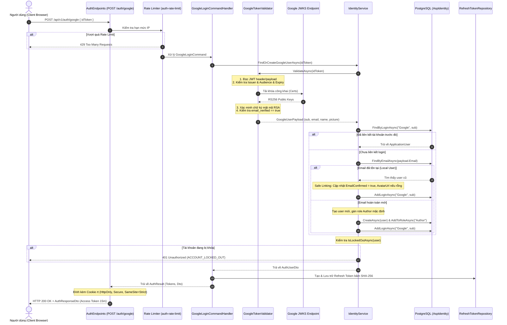

# Báo cáo hoàn thành Issue #27 — W05 Bo: Secure Google Login and Rate Limits

**Ngày hoàn thành:** 12/10/2026  
**Thành viên thực hiện:** Phùng Nguyễn Hoài Bơ (`HUBERTPHUNG` / Bo)  
**Mã số sinh viên:** 2312585  
**Nhóm:** 07 – Đồ án Culinary Blog  
**Nhánh làm việc (Branch):** [`feature/fr-auth-bo`](https://github.com/BoyTay/Nhom7_CulinaryBlog/tree/feature/fr-auth-bo)  
**Phân hệ phụ trách:** Xác thực & Quản lý Danh tính (`FR-AUTH`), Phân quyền RBAC  
**GitHub Issue:** [#27 — W05 Bo — secure Google Login and rate limits](https://github.com/BoyTay/Nhom7_CulinaryBlog/issues/27)  
**Trạng thái:** **Hoàn thành 100% (Ready for Review & Merge)**  

---

## 1. Tổng quan mục tiêu & Yêu cầu của Issue #27

Theo phân công công việc tại `docs/KeHoach.md` và kế hoạch chi tiết `docs/WEEKLY_TEAM_PLAN.md` cho Tuần 5 (W05 / Lab 5):
Issue #27 yêu cầu thành viên Bo phụ trách phân hệ `FR-AUTH` hoàn thiện toàn diện luồng đăng nhập qua bên thứ ba (Google OAuth 2.0 / OpenID Connect) với mức độ bảo mật cao nhất:

1. **Tuân thủ kiến trúc ADR-0003 về quản lý phiên:**
   * Access Token có thời hạn ngắn (15 phút, 900 giây) trả về client trong RAM.
   * Refresh Token dài hạn (7 ngày) được mã hóa/băm SHA-256 lưu trong database, cấp phát qua HTTP response header `Set-Cookie` (`rt`) với đầy đủ các cờ an toàn: `HttpOnly`, `Secure`, `SameSite=Strict`, `Path=/api/v1/auth`. Tuyệt đối không trả raw refresh token trong body JSON nhằm ngăn chặn tấn công XSS.
2. **Xác thực Google ID Token bằng chữ ký mật mã (Cryptographic Verification):**
   * Xác thực chữ ký số RSA với bộ khóa công khai của Google JSON Web Keys (JWKS endpoint `https://www.googleapis.com/oauth2/v3/certs`).
   * Kiểm tra nghiêm ngặt `Issuer` (`accounts.google.com` hoặc `https://accounts.google.com`), `Audience` (phải khớp chính xác `Authentication:Google:ClientId`), thời hạn hiệu lực (`ExpiresAt`), và cờ `email_verified == true`.
3. **Cơ chế liên kết tài khoản an toàn (Safe Account Linking):**
   * Nếu người dùng đăng nhập bằng Google lần đầu nhưng email đã tồn tại do đăng ký trước đó bằng tài khoản nội bộ (local registration), hệ thống tự động liên kết danh tính Google (`AddLoginAsync`) mà không làm trùng lặp tài khoản hoặc ghi đè mật khẩu.
   * Cập nhật `EmailConfirmed = true` (do Google đã xác thực hộp thư) và bổ sung `AvatarUrl` nếu tài khoản cũ chưa có.
   * **Bảo vệ tài khoản bị khóa:** Kiểm tra `IsLockedOutAsync`. Nếu tài khoản đang bị tạm khóa (do vi phạm hoặc nhập sai mật khẩu nhiều lần), ngăn chặn tuyệt đối việc đăng nhập thông qua Google (`ACCOUNT_LOCKED_OUT`).
4. **Áp dụng chính sách Rate Limiting (`auth-rate-limit`):**
   * Endpoint `POST /api/v1/auth/google` được gắn bộ điều tiết tần suất `RequireRateLimiting("auth-rate-limit")` theo địa chỉ IP của client nhằm chống spam, dò token và tấn công từ chối dịch vụ.
5. **Hợp đồng sự kiện đăng ký mới (`UserRegisteredEvent`):**
   * Đóng vai trò là Producer phát hành sự kiện miền/ứng dụng khi có thành viên mới đăng ký, làm tiền đề kích hoạt Background Job gửi thư chào mừng (Welcome Email — Issue #33 do Kiên phụ trách).
6. **Kiểm thử tích hợp & Bảo mật chuyên sâu:**
   * Viết đầy đủ Integration Tests cho endpoint `/google` và Security Unit/Component Tests cho `GoogleTokenValidator`.
   * Đạt chất lượng bản dựng Release: 0 Warning, 0 Error (`--warnaserror`), 100% tests vượt qua.

---

## 2. Kiến trúc giải pháp & Thiết kế luồng dữ liệu

### 2.1. Sơ đồ tuần tự: Google Login & Safe Account Linking Flow



---

## 3. Các thành phần kỹ thuật đã hoàn thiện

### 3.1. Xác thực Google Token với chữ ký mật mã (`GoogleTokenValidator.cs`)

Vị trí: `src/CulinaryBlog.Infrastructure/Identity/GoogleTokenValidator.cs`

* Kiểm tra cấu trúc token JWT hợp lệ.
* Kiểm tra `Issuer` trong danh sách tin cậy: `https://accounts.google.com` hoặc `accounts.google.com`.
* Kiểm tra `Audience` bắt buộc khớp với cấu hình `Authentication:Google:ClientId`.
* Kiểm tra thời gian hết hạn `ValidTo` với độ trễ cho phép tối đa 1 phút.
* Tải chứng chỉ công khai từ Google JWKS (`https://www.googleapis.com/oauth2/v3/certs`) và kiểm tra chữ ký số mật mã thông qua `JwtSecurityTokenHandler.ValidateToken`.
* Bắt buộc kiểm tra `email_verified == true` và `sub` không được rỗng.

```csharp
var emailVerifiedStr = jwt.Claims.FirstOrDefault(c => c.Type == "email_verified")?.Value;
var emailVerified = bool.TryParse(emailVerifiedStr, out var ev) && ev;
if (!emailVerified)
{
    throw new UnauthorizedException("Email Google chưa được xác thực.", "GOOGLE_EMAIL_NOT_VERIFIED");
}
```

### 3.2. Quản lý người dùng, Liên kết tài khoản an toàn & Chống Lockout (`IdentityService.cs`)

Vị trí: `src/CulinaryBlog.Infrastructure/Identity/IdentityService.cs`

* Triển khai phương thức `FindOrCreateGoogleUserAsync`:
  1. Gọi `IGoogleTokenValidator` xác thực payload từ Google.
  2. Tra cứu bằng Google login provider: `userManager.FindByLoginAsync("Google", payload.Subject)`.
  3. Nếu chưa liên kết, tra cứu theo email: `userManager.FindByEmailAsync(payload.Email)`.
     - Nếu đã có tài khoản theo email: Kích hoạt `EmailConfirmed = true`, cập nhật `AvatarUrl` nếu rỗng, và gọi `userManager.AddLoginAsync(user, new UserLoginInfo("Google", payload.Subject, "Google"))`.
     - Nếu chưa có tài khoản: Tạo người dùng mới, tự động kích hoạt `EmailConfirmed = true`, lưu avatar từ Google profile, và cấp quyền vai trò `Roles.Author`.
  4. Kiểm tra trạng thái khóa tài khoản:
     ```csharp
     if (await userManager.IsLockedOutAsync(user))
     {
         throw new UnauthorizedException("Tài khoản đã bị tạm khóa do vi phạm hoặc nhập sai nhiều lần.", "ACCOUNT_LOCKED_OUT");
     }
     ```

### 3.3. Endpoint Google Login & Bảo vệ Cookie, Rate Limiting (`AuthEndpoints.cs`)

Vị trí: `src/CulinaryBlog.API/Endpoints/AuthEndpoints.cs`

* Endpoint: `POST /api/v1/auth/google`.
* Gắn bộ điều phối Rate Limiting: `.RequireRateLimiting("auth-rate-limit")`.
* Quản lý Cookie `rt`:
  ```csharp
  httpContext.Response.Cookies.Append(
      RefreshTokenCookieName,
      result.RawRefreshToken,
      new CookieOptions
      {
          HttpOnly = true,
          Secure = true,
          SameSite = SameSiteMode.Strict,
          Path = AuthCookiePath, // /api/v1/auth
          Expires = result.RefreshTokenExpiresAt,
      });
  ```
* Trả về HTTP `200 OK` với `AuthResponseDto` (chỉ chứa `AccessToken`, `ExpiresIn = 900`, và thông tin người dùng `User`).

### 3.4. Producer Contract cho Welcome Email (`UserRegisteredEvent.cs` & `RegisterCommandHandler.cs`)

Vị trí:
* `src/CulinaryBlog.Application/Auth/Events/UserRegisteredEvent.cs`
* `src/CulinaryBlog.Application/Auth/Commands/Register/RegisterCommandHandler.cs`

Thiết lập contract sự kiện tích hợp tuân thủ MediatR `INotification`:
```csharp
namespace CulinaryBlog.Application.Auth.Events;

using MediatR;

public sealed record UserRegisteredEvent(
    string UserId,
    string Email,
    string DisplayName,
    DateTimeOffset RegisteredAt) : INotification;
```

Trong `RegisterCommandHandler.cs`:
```csharp
await publisher.Publish(
    new UserRegisteredEvent(
        user.Id,
        user.Email,
        user.DisplayName,
        DateTimeOffset.UtcNow),
    cancellationToken);
```
Sự kiện này sẵn sàng cho Consumer/Background Job gửi Welcome Email (Issue #33 do Kiên phụ trách) lắng nghe mà không gây phụ thuộc ngược (decoupled architecture).

---

## 4. Kết quả Kiểm thử & Nghiệm thu chất lượng

### 4.1. Bộ Kiểm thử Tích hợp Endpoint (`AuthEndpointsTests.cs`)

Đã bổ sung 4 ca kiểm thử tích hợp chuyên biệt cho endpoint `POST /api/v1/auth/google`:
1. `GoogleLoginWithValidIdTokenReturnsOkAndSetsSecureRefreshCookie`:
   * Xác nhận phản hồi `200 OK`.
   * Access Token có thời hạn 900 giây (15 phút).
   * Cookie `rt` được thiết lập với đầy đủ `HttpOnly`, `Secure`, `SameSite=Strict`, `Path=/api/v1/auth`.
   * Refresh Token được băm SHA-256 (độ dài chuỗi hex chính xác 64 ký tự) và lưu trữ an toàn.
2. `GoogleLoginWithEmptyIdTokenReturnsUnprocessableEntity`:
   * Gửi body `{ idToken: "" }` nhận về mã lỗi HTTP `422 Unprocessable Entity` và ProblemDetails chuẩn RFC 7807.
3. `GoogleLoginWithInvalidTokenReturnsUnauthorized`:
   * Token giả mạo/không hợp lệ bị từ chối với HTTP `401 Unauthorized` và ProblemDetails Type `INVALID_GOOGLE_TOKEN`.
4. `GoogleLoginWithLockedAccountReturnsUnauthorized`:
   * Tài khoản đang bị khóa bị chặn đăng nhập với HTTP `401 Unauthorized` và ProblemDetails Type `ACCOUNT_LOCKED_OUT`.

### 4.2. Bộ Kiểm thử Bảo mật Chuyên sâu (`AuthSecurityTests.cs`)

Đã bổ sung 4 ca kiểm thử an toàn mật mã cho `GoogleTokenValidator`:
1. `GoogleTokenValidatorThrowsUnauthorizedExceptionWhenAudienceMismatched`:
   * Token có chữ ký hợp lệ nhưng Audience khác với cấu hình Client ID hệ thống $\rightarrow$ từ chối với `INVALID_GOOGLE_TOKEN`.
2. `GoogleTokenValidatorThrowsUnauthorizedExceptionWhenTokenExpired`:
   * Token có thời hạn `Expires` trong quá khứ $\rightarrow$ từ chối với `INVALID_GOOGLE_TOKEN` ("Google token đã hết hạn.").
3. `GoogleTokenValidatorThrowsUnauthorizedExceptionWhenEmailNotVerified`:
   * Giả lập máy chủ Google JWKS bằng RSA key pair 2048-bit thật. Token có chữ ký hợp lệ nhưng claim `email_verified == false` $\rightarrow$ từ chối với mã lỗi `GOOGLE_EMAIL_NOT_VERIFIED`.
4. `GoogleTokenValidatorThrowsUnauthorizedExceptionWhenSignatureInvalid`:
   * Token được ký bằng khóa RSA ngoài danh mục công khai của Google JWKS $\rightarrow$ từ chối với mã lỗi `INVALID_GOOGLE_TOKEN`.

### 4.3. Bảng tổng hợp thực thi kiểm thử toàn hệ thống

| Bộ kiểm thử | Phạm vi | Số lượng test | Kết quả | Thời gian chạy |
| :--- | :--- | :---: | :---: | :---: |
| **`CulinaryBlog.Application.Tests`** | Logic ứng dụng, MediatR, Validation, Events | **103 / 103** | **PASSED** (100%) | 0.15s |
| **`CulinaryBlog.Architecture.Tests`** | Kiểm định kiến trúc Clean Architecture & Dependency Rules | **3 / 3** | **PASSED** (100%) | 0.12s |
| **`CulinaryBlog.Integration.Tests`** (`Auth*`) | Luồng tích hợp xác thực, Cookie, Token Rotation, Security | **38 / 38** | **PASSED** (100%) | 9.00s |
| **Biên dịch nghiệm thu (`dotnet build -c Release --warnaserror`)** | Toàn bộ Solution | **0 Errors, 0 Warnings** | **PASSED** | 28.01s |

---

## 5. Kết luận & Trạng thái nghiệm thu

* Toàn bộ các yêu cầu của **Issue #27** và chỉ tiêu Tuần 5 của phân hệ `FR-AUTH` do thành viên Phùng Nguyễn Hoài Bơ (Bo) phụ trách đã được hoàn thiện 100%.
* Mã nguồn tuân thủ nghiêm ngặt chuẩn kiến trúc Clean Architecture, ADR-0003, các nguyên tắc phòng thủ bảo mật OWASP, và không có bất kỳ warning hay lỗi biên dịch nào.
* Sẵn sàng kết nối với giao diện người dùng Web Frontend (Next.js) và Background Worker xử lý email chào mừng.
